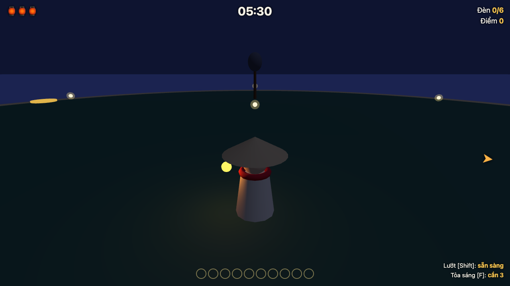
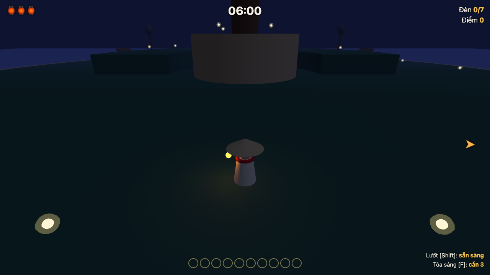
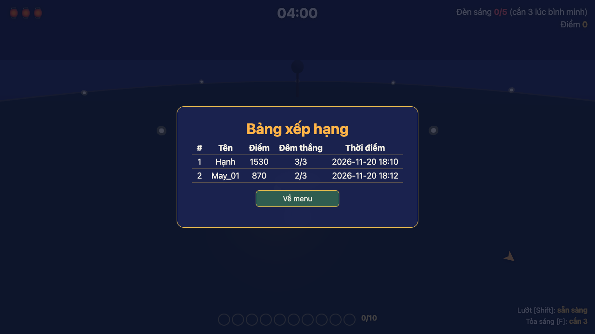

# Đảo Đèn Lồng · v1.0.0

> **Video demo:** [docs/demo/demo.mp4](docs/demo/demo.mp4) (cũng đính kèm trong GitHub Release `v1.0.0`)
> Day 12 · AI SDLC Lab · 2A202603537 · Nguyễn Thị Hồng Hạnh · Tài liệu lab gốc: [docs/lab/](docs/lab/)

Game 3D góc nhìn thứ ba (Three.js, chạy trên trình duyệt). Người chơi điều khiển Mây, người giữ đèn đội nón lá có treo đèn lồng nhỏ, đi qua ba hòn đảo trong một đêm. Mây gom đom đóm để thắp và châm dầu cho các Đèn Lồng Lớn, xua Bóng Mực, tránh Gió Lạc, và **giữ đảo sáng tới bình minh**.

| Đêm 2: Đảo Cau | Đêm 3: Đảo Chuông | Bảng xếp hạng |
|---|---|---|
|  |  |  |

## Yêu cầu hệ thống

- macOS hoặc Linux, **Node.js ≥ 18** (đã thử với Node 26 trên macOS 26, Apple M1).
- Trình duyệt có WebGL 2 (Chrome, Edge, Firefox, Safari). Không cần mạng khi chơi: Three.js được cài qua npm.
- Chỉ benchmark mới cần Chrome. `scripts/bench.js` tự tải Chrome for Testing ở lần chạy đầu (khoảng 170 MB), nếu không tải được thì dùng Google Chrome có sẵn trên máy.

## Cài đặt và chạy (3 lệnh)

```bash
git clone <repo-url> && cd K5-L3A-DAY12-NguyenThiHongHanh-2A202603537-AI-SDLC-Dao-Den-Long
npm install
node server.js        # rồi mở http://localhost:5173
```

Bản phát hành chạy ngay không cần `npm install`: tải `dao-den-long-v1.0.0.zip` trong GitHub Release `v1.0.0`, giải nén, chạy `node server.js`.

## Điều khiển (đổi được trong Cài đặt)

| Phím mặc định | Hành động |
|---|---|
| `W A S D` / phím mũi tên | Di chuyển theo hướng camera |
| `Space` | Nhảy |
| `Shift` trái | Lướt (14 m/s trong 0.2 s, hồi chiêu 1.5 s) |
| `E` | Thắp đèn hoặc châm dầu cho đèn gần nhất (trong 2 m) |
| `F` | Tỏa sáng: tốn 3 đom đóm, làm choáng Bóng Mực trong 5 m |
| `P` / `Esc` | Tạm dừng: Tiếp tục / Chơi lại Đêm / Cài đặt / Về menu |
| Kéo chuột, `Q` / `C` | Xoay camera |

**Dễ tiếp cận** (menu Cài đặt, được lưu lại): đổi phím cho mọi hành động (cảnh báo khi trùng phím, có nút khôi phục mặc định), bảng màu dễ phân biệt, giảm chuyển động (tắt rung camera và chớp sáng), chữ lớn ×1.25 (chữ tối thiểu 18 px), phụ đề cảnh báo (Bóng Mực xuất hiện kèm mũi tên ở mép màn hình, gió sắp thổi, 10 giây cuối, đèn sắp cạn dầu).

## Luật chơi và điểm (Contract v1.3)

Ba Đêm: **Đảo Bến** (5 đèn, 240 s), **Đảo Cau** (2 đảo, cầu tre, bục nhảy, 6 đèn, 270 s), **Đảo Chuông** (3 tầng, gió mạnh, 7 đèn, 300 s). Mỗi Đêm Mây có lại đủ 3 lửa.

- **Thắng** khi còn sống lúc hết giờ **và** số đèn đang sáng ≥ 60% (3/5, 4/6, 5/7). Thắp đủ đèn không kết thúc Đêm sớm.
- Thắp lần đầu cần 10 đom đóm. Đèn sáng có dầu 100, giảm 1 mỗi giây; `E` để châm (+10 dầu mỗi đom đóm). Hết dầu thì đèn tắt; thắp lại cần 5.
- Đèn có dầu < 30 nhấp nháy và mất vùng an toàn 6 m: Bóng Mực sẽ tới hút dầu (5/giây).
- Sức chứa = 10 + 2 × số lần thắp thành công (tối đa 20).
- Bóng Mực chạm: −1 lửa và rơi một nửa số đom đóm đang mang. Rơi khỏi đảo: −1 lửa và mất toàn bộ đom đóm. **Gió Lạc** (Đêm 2–3) cướp 3 đom đóm. **Bùa Gió**: 10 s chạy nhanh và lướt không hồi chiêu.

| Sự kiện | Điểm |
|---|---|
| Mỗi đom đóm nạp vào đèn (thắp, thắp lại, châm dầu) | +5 |
| Thắp lần đầu / thắp lại | +100 / +40 |
| Mỗi Bóng Mực trúng tỏa sáng (nếu đang hút dầu) | +5 (+15) |
| Bình minh khi thắng: mỗi đèn đang sáng / mỗi lửa còn lại | +50 + phần nguyên của dầu / +50 |

Tổng điểm là tổng điểm các Đêm đã thắng. Sau màn Bình Minh, hoặc sau khi thua, nhập tên (3–12 ký tự, có dấu cũng được) để lưu vào **bảng xếp hạng top 10**. Bảng được lưu trên đĩa ở `data/leaderboard.json` và mở được từ menu chính.

## Test, headless, benchmark, soak

| Việc | Lệnh | Kết quả trên máy tác giả (Apple M1) |
|---|---|---|
| Toàn bộ test (65) | `npm test` | 65/65 pass, cũng chạy trên CI mỗi lần push |
| Headless (Test Contract) | `node src/headless.js --seed 1 --night 1\|2\|3 --ticks 600 --out out.jsonl [--scenario s.json] [--inputs i.json]` | một Đêm đủ giờ chạy dưới 0.3 s |
| Benchmark | `node scripts/bench.js --seed 42 --duration 30 --out bench.json` | [bench.json](bench.json): avg 291 fps, p1 low 108 fps, load 3.3 s |
| Soak test | `node --expose-gc --jitless src/soak.js --seed 7 --nights 10 --out soak.json` | [soak.json](soak.json): 0 crash, bộ nhớ 13.6 → 15.4 MB (1.13×) |
| Xuất bảng xếp hạng | `node server.js --export-leaderboard out.json` | `{"entries":[…]}` theo đúng thứ hạng |
| Sinh lại bằng chứng | `scripts/proof.sh phase-4` | [docs/proof/](docs/proof/) |

Ghi chú:
- **Benchmark** mở cửa sổ Chrome 1280×720 (không toàn màn hình), tắt vsync bằng `--disable-gpu-vsync --disable-frame-rate-limit`. `peak_mem_mb` là RSS cao nhất của cả cây tiến trình Chrome. Đặt `BENCH_HEADLESS=1` để chạy không cửa sổ (khi đó số đo không so sánh được).
- **Soak** chạy với `--jitless`: dữ liệu game không tăng (heap 4.2–4.4 MB suốt 30 Đêm), nhưng mã JIT của V8 làm RSS tăng khoảng 1.9×. Chi tiết trong [docs/notes/phase-4.md](docs/notes/phase-4.md).

## Sáng tạo của tôi

Mọi phần sáng tạo **chỉ nằm ở lớp hiển thị** ([src/web/main.js](src/web/main.js)). Chúng không đụng tới simulation nên output headless không đổi. Trong benchmark chúng không hoạt động: cảnh bench không phát sự kiện, không có âm thanh và không hiện màn giới thiệu.
1. **Đèn hửng dần** theo số đom đóm đã nạp, và có vòng đom đóm xoáy khi thắp.
2. **Đèn trên nón lá** của Mây to và sáng hơn khi mang nhiều đom đóm.
3. **Âm thanh tổng hợp bằng WebAudio**, không dùng file: mỗi đom đóm nhặt được phát một nốt cao dần; mỗi Đêm có nhạc nền theo một thang âm riêng; có hợp âm khi thắp đèn.
4. **Lời giới thiệu của Ông Đăng** trước mỗi Đêm.

Bằng chứng phần lõi vẫn đúng: 65 test headless pass ([docs/proof/phase-4/test-output.txt](docs/proof/phase-4/test-output.txt)), và các thay đổi sáng tạo chỉ nằm trong `src/web/`.

## Tài liệu

| Tài liệu | Nội dung |
|---|---|
| [CHANGELOG.md](CHANGELOG.md) | Thay đổi theo 4 phase, kèm các thay đổi phá vỡ tương thích |
| [docs/spec/](docs/spec/) · [docs/adr/](docs/adr/) | Giả định và tiêu chí nghiệm thu; quyết định thiết kế |
| [docs/notes/](docs/notes/) | Đánh giá và nhật ký AI mỗi phase |
| [docs/retro.md](docs/retro.md) | Retro toàn dự án |
| [AGENTS.md](AGENTS.md) · [.claude/](.claude/) | Harness AI: hướng dẫn agent, Stop hook chặn kết thúc khi test đỏ, skill `contract-check` |
| [CREDITS.md](CREDITS.md) · [LICENSE](LICENSE) | Nguồn và công cụ; giấy phép MIT |
